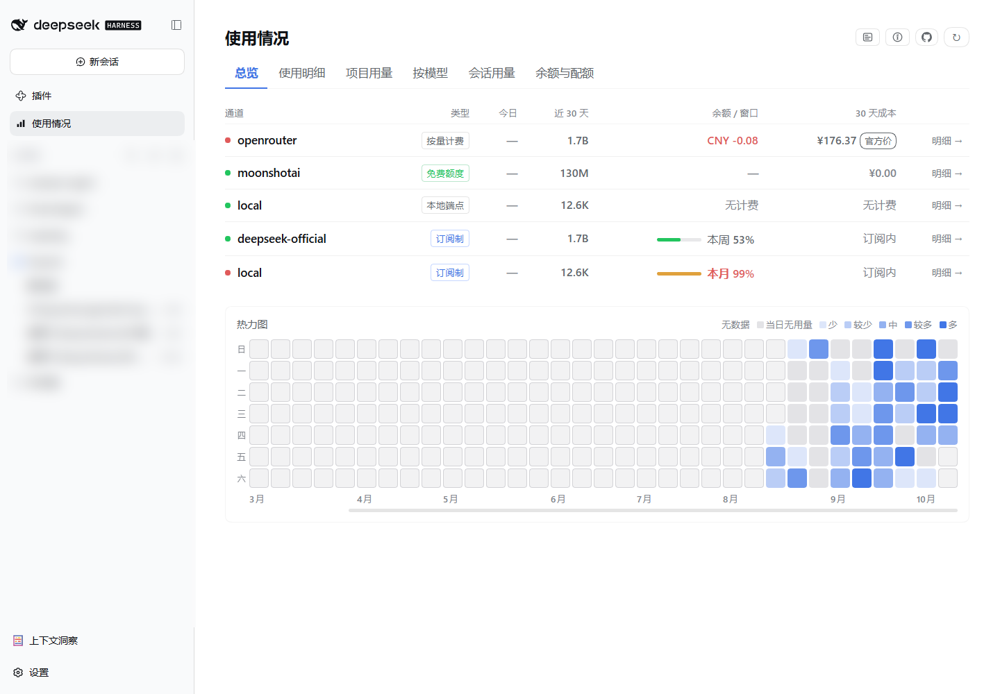
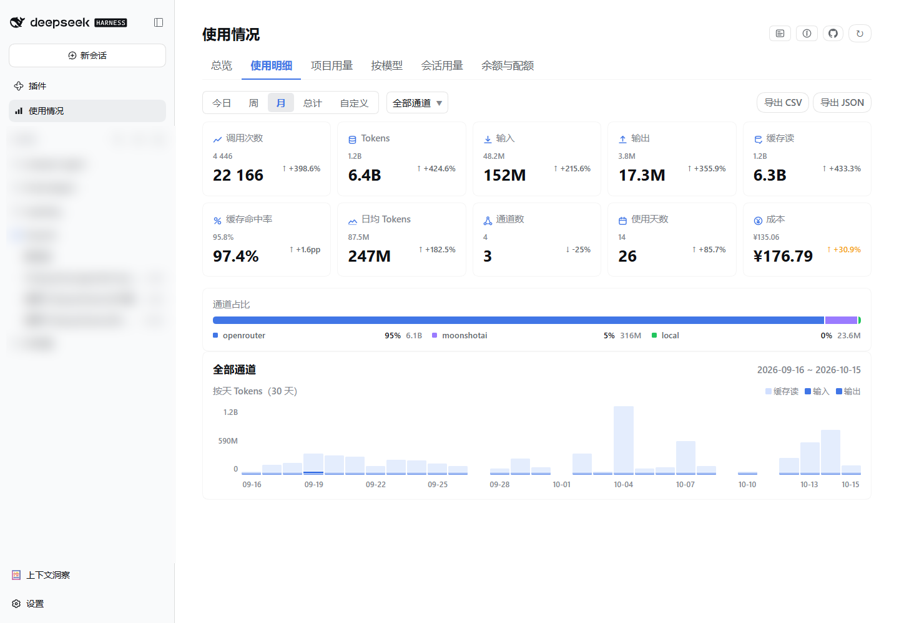
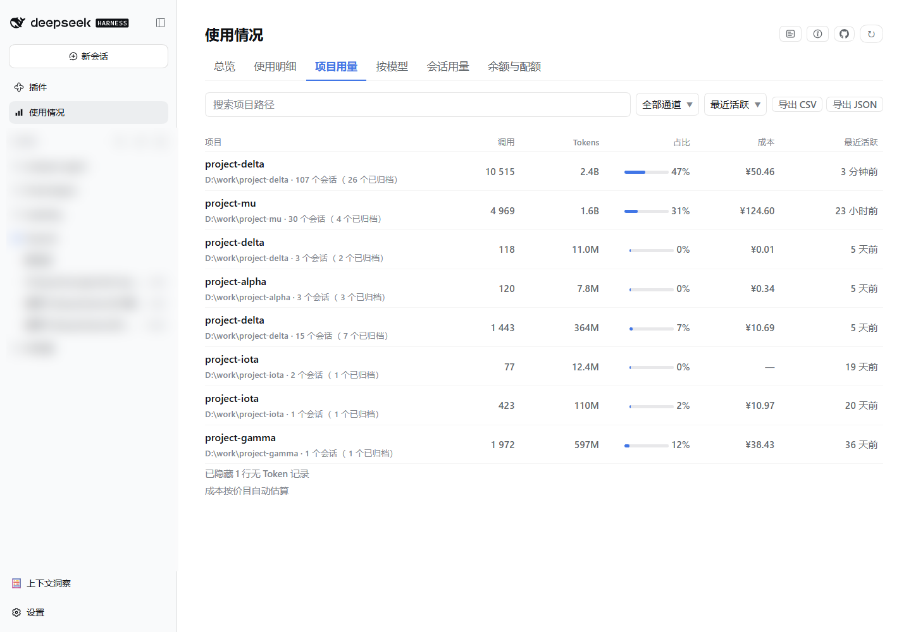
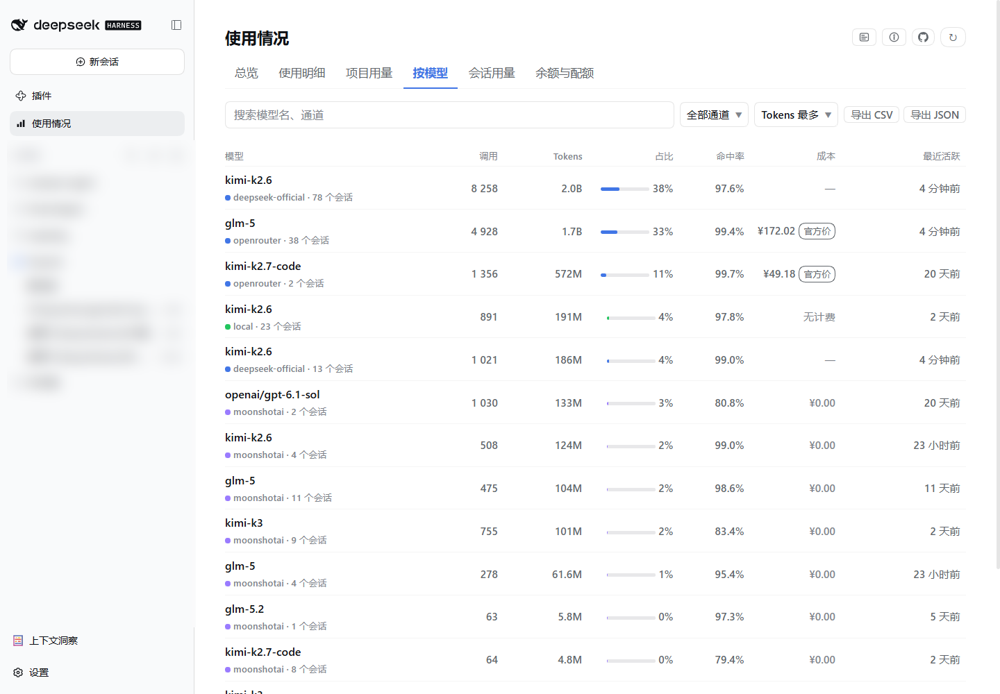
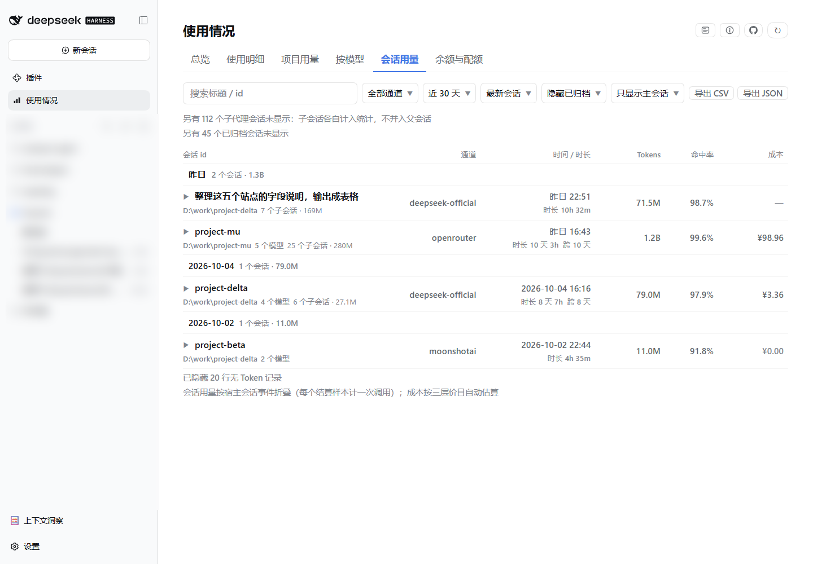
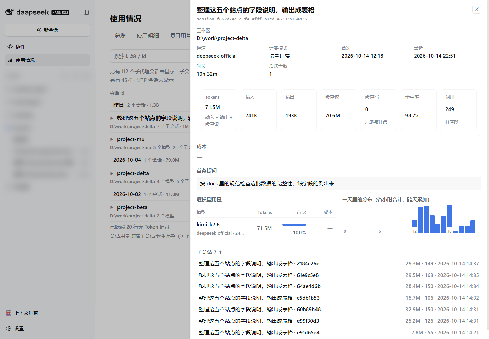
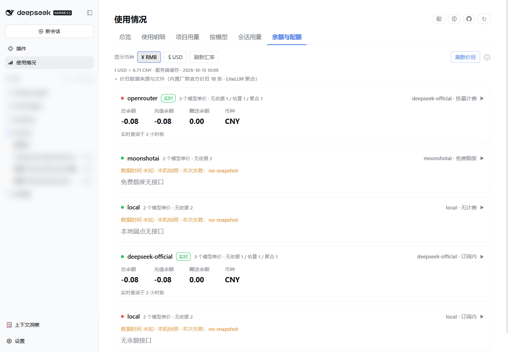

<div align="center">

# 使用情况 · dsh-key-usage

**DeepSeek Harness 的侧边栏用量面板** —— 按通道看 Token、缓存命中率、成本，以及余额与订阅窗口。

[](https://www.npmjs.com/package/dsh-key-usage)
[](./LICENSE)
[](#兼容与运行要求)
[](#兼容与运行要求)
[](https://github.com/topics/dsh-plugin)
[](https://dsh-plugin.org/plugins/xyl886/dsh-key-usage)

[安装](#安装) · [界面预览](#界面预览) · [数据与权限](#数据权限与联网) · [功能](#功能) · [成本与价目](#成本与价目) · [常见问题](#常见问题) · [更新记录](./docs/CHANGELOG.md) · [开发](#开发)

</div>

---

侧边栏「使用情况」：**总览（通道清单 + 活跃热力图）、使用明细、项目用量、按模型、会话用量、余额与配额**。数据全部来自你自己的机器，**默认不联网**；界面**中英双语**（跟随宿主语言设置），字号跟随宿主通用设置。

## 安装

```bash
dsh plugin --profile web add dsh-key-usage
dsh plugin --profile desktop add dsh-key-usage
```

## 界面预览

<p align="center">
  <br />
  <sub><b>总览</b> —— 每通道一行（今日 / 近 30 天 / 余额或窗口 / 30 天成本），下方是近 9 个月活跃热力图</sub>
</p>

<p align="center">
  <br />
  <sub><b>使用明细</b> —— 十张统计卡（每张带上期值与环比角标）、通道下拉筛选、占比一次列全、按天 / 按小时图表</sub>
</p>

<p align="center">
  <br />
  <sub><b>项目用量</b> —— 按工作目录聚合，含会话数与归档标记；支持搜索、按通道筛选与排序</sub>
</p>

<p align="center">
  <br />
  <sub><b>按模型</b> —— 按通道 + 模型聚合，成本带「官方价 / 聚合 / 估算」来源角标</sub>
</p>

<p align="center">
  <br />
  <sub><b>会话用量</b> —— 按会话聚合、按日期分组，支持搜索与四种排序；没有人类提问的会话不显示</sub>
</p>

<p align="center">
  <br />
  <sub><b>会话详情</b> —— 首条提问全文、四类 tokens 与命中率、逐模型占比、一天里的分布；有子代理时列出子会话</sub>
</p>

<p align="center">
  <br />
  <sub><b>余额与配额</b> —— 官方余额或订阅窗口占用、¥ / $ 折算、可展开的通道单价表</sub>
</p>

## 数据、权限与联网

**读什么**

| 读取对象 | 用途 |
| --- | --- |
| `$DSH_HOME/dsh-usage/usage-ledger.json` | 用量台账（天 × 通道 × 模型，含官方成本） |
| `$DSH_HOME/dsh-usage/provider-snapshots.json` | 余额 / 窗口的**回落值** |
| `$DSH_HOME/profiles/<profile>/cordis.yml` | 通道清单（只做文本提取，**不执行**其中的 `!!js`；取不到回退 `cordis.patch.yml`） |
| 宿主 `sessionPersistence` 服务 | 项目 / 会话 / 单会话详情 / 按小时（只开只读句柄，不自行解压会话文件） |
| 宿主 `credentials` 服务 / 进程环境变量 | 查余额时的 API Key（只用于拼 `Authorization`） |
| 随包 `data/litellm-model-prices.json`、`$DSH_HOME/dsh-key-usage/model-prices.json`、`fx-rate.json` | 聚合价目与汇率缓存 |

**写什么**（只有三处，都在 `$DSH_HOME/dsh-key-usage/`）：

- `snapshot.json` —— 统一快照：6 个 Tab 的数据（含明细），每 5 分钟本地重建一次，点「刷新」时整体重算；
- `model-prices.json` —— 点「刷新价目」成功后写入的聚合价目副本（校验不过不覆盖旧文件）；
- `fx-rate.json` —— 汇率缓存（成功才写，12 小时内直接复用）。

三个文件都不含任何密钥；宿主的 `provider-snapshots.json` 与 profile 配置一律只读。**不读凭据文件、不改宿主配置、所有端点仅接受回环请求** —— 完整约束见 [`AGENTS.md`](./AGENTS.md)。

**会联网的三个动作，都要你触发**：

| 动作 | 说明 |
| --- | --- |
| 打开「余额与配额」 | 按通道查官方余额 / 窗口接口；6 秒超时、64 KiB 上限、结果缓存 60 秒（点「刷新」强制重查），失败回落本机快照并写明原因 |
| 点「刷新价目」 | `POST /dsh-key-usage/pricing/refresh`：先 `raw.githubusercontent.com`、失败再试 jsDelivr 镜像；服务端 20 秒预算、响应上限 12 MiB，校验不过**不覆盖**已有文件；界面最多等 30 秒 |
| 打开页面 / 切换显示币种 / 点「刷新汇率」 | `GET /dsh-key-usage/fx`：主 `open.er-api.com`、备 `api.frankfurter.app`；6 秒超时、64 KiB 上限、12 小时 TTL 内不联网；失败回落缓存，再失败用默认 7.1 并在界面明示 |

**不做开机拉取、不做定时轮询、不在其它端点里隐式联网**。

**界面语言与字号**：文案全部走词典（中 / 英），语言**只跟宿主设置**（设置 → 通用 → 语言），插件内不加语言开关；字号按宿主注入的 `--dsh-content-font-size` 缩放，**通用设置里改字号，插件整页跟着变**。

## 功能

**总览**

- **通道清单** —— 每通道一行：类型、今日与近 30 天调用量、余额或订阅窗口占用、30 天成本（带来源角标）；
- **活跃热力图** —— 近 9 个月按日 Tokens，五档深浅递进，格子按可见区间的**活跃日五分位**分档（p20 / p40 / p60 / p80）；横向滚动时星期列固定在左侧。

**使用明细**

- 今日 / 周 / 月 / 总计 / 自定义范围 + **通道下拉**（在「自定义」右侧），全页联动；
- **十张统计卡**：调用次数、Tokens、输入、输出、缓存读、缓存命中率、日均 Tokens、通道数、使用天数、成本；
- 每张卡带**上期值（缩小淡化）与环比角标**：命中率按百分点（`pp`）记，成本上升用提示色；没有可比基数或持平时不显示角标，「总计」范围整组不显示；
- **通道占比**：条下方一次列全每段（色块 / 名称 / 占比 / Tokens），悬停条上任意位置弹**一个** tip 列出全部段；
- 按天 / 按小时图表（单日范围自动切 24 小时），悬停柱子看当日调用数、四类 tokens、命中率、成本与模型构成。

**项目用量 · 按模型 · 会话用量**

- 分别按工作目录、通道 + 模型、单个会话聚合，支持搜索、按通道筛选与排序；会话按日期分组，可切换显示已归档会话，**没有人类提问的会话不再显示**；
- **会话详情抽屉**：首条真实提问全文、工作区、通道、时长、四类 tokens 与命中率、成本与来源角标、逐模型占比，有结算样本时给 24 小时迷你图；
- 会话列表可按成本 / 命中率 / 调用数排序，标「跨 N 天」，可展开看模型构成；首屏 50 条 + 「加载更多」；点行内工作目录跳到「项目用量」并只看该项目。

**导出**

- 上面四处都能把**当前筛选后**的数据导出为 CSV 或 JSON（CSV 带 UTF-8 BOM）。

**系统日志**

- 页头右侧的日志图标：弹窗列出**时间 / 级别 / 来源 / 内容**，可复制、可清空；
- 自动记录 **i18n 缺词**（界面文案没翻译全时）与**端点请求失败**，同一问题只记一次；日志只存在内存、不落盘、不新增写入文件。

**余额与配额**

- 每个通道一张卡片：官方余额（总余额 / 赠送 / 充值）或订阅窗口占用（5 小时 / 本周 / 本月 + 重置时间）；成功带「实时」标签与查询时间，失败写明原因并回落快照；
- **卡片可点击展开**：展开后是该通道近 30 天用到的模型**单价表** —— 模型 · 四档单价（每百万 tokens）· 来源（官方价 / 聚合 / 估算 / 无依据）· 「· 部分」· 「错峰中」· 近 30 天 tokens；
- 工具条：**¥ RMB / $ USD 切换**（全页金额按汇率折算显示，折算值带 `≈`）、刷新汇率、刷新价目、成本口径 ⓘ。

## 成本与价目

**取值优先级（四层）**：`官方账单`（台账记录的厂商账单，不会被覆盖）→ `内置官方价目` → `LiteLLM 聚合价` → `台账反推均价`；都没有则显示 `—`。

| 角标 | 含义 |
| --- | --- |
| **官方** | 台账记录的厂商账单金额 |
| **官方价** | 按插件**内置的厂商官方价目**算出（随包发布、自动生效） |
| **聚合** | 按随包的 **LiteLLM 聚合价目**算出（第三方维护、美元计价） |
| **估算** | 三层都没收录时，按台账反推的均价推算 |

> 「**· 部分**」是口径提示、不是错误：该条聚合价目缺一档缓存价，缺的那档按**未命中价**代；两档都缺的条目按「不支持缓存计价」处理，不标「部分」。

**内置价目**（18 条，2026-10-13 抓取；随包发布的 `data/pricing-catalog.yml`，**不要改它**，升级会覆盖）：

| 通道 | 模型 | 币种 | 来源 |
| --- | --- | --- | --- |
| `deepseek-official` | deepseek-flash · deepseek-v4-flash · deepseek-v4-flash-vision-exp · deepseek-v4-pro | CNY | [api-docs.deepseek.com](https://api-docs.deepseek.com/zh-cn/quick_start/pricing) |
| `moonshotai` | kimi-k3 · kimi-k2.7-code · kimi-k2.7-code-highspeed · kimi-k2.6 | CNY | [platform.kimi.com](https://platform.kimi.com/docs/pricing/chat) |
| `zai` | glm-5.3 · glm-5.3-flash · glm-5.3-flashx · glm-5.2 · glm-5 | USD | [docs.z.ai](https://docs.z.ai/guides/overview/pricing) |
| `openrouter` | deepseek/deepseek-v4.1-flash · anthropic/claude-sonnet-5.5 · anthropic/claude-opus-5.5 · openai/gpt-6.1-sol · openai/gpt-6-astra | USD | [openrouter.ai](https://openrouter.ai/api/v1/models) |

- 币种按各家定价页**原样记录**（CNY / USD 并存，显示时按汇率折算）；文档没写清的档位**留空而不是猜**（例如 Kimi K2 系列未公布缓存写入价 → 该档按 0 计）；
- **错峰**：窗口按**本地时间**判定（`起止相同` = 全天，`from > to` = 跨午夜），可限定每天 / 仅工作日 / 仅周末；只有**单日范围**会用当天的 24 小时分布算错峰占比并加权，跨天按标准价（有意保守）。DeepSeek 按官方口径：**北京时间周一至周五 9:00–12:00 与 14:00–18:00 为高峰，其余（含周末）为空闲半价**；插件没有法定节假日日历，**节假日按高峰价算**（偏高、保守）。

**聚合价目**（[BerriAI/litellm](https://github.com/BerriAI/litellm) 的 [`model_prices_and_context_window.json`](https://github.com/BerriAI/litellm/blob/main/model_prices_and_context_window.json)，MIT，原文随包在 [`data/litellm-LICENSE.txt`](./data/litellm-LICENSE.txt)）：

- 随包快照 2,797,533 B、sha256 `6b5e1ee7…63e403`、upstream commit `30b8db32…`、抓取 2026-10-14（详见 [`data/README.md`](./data/README.md)）；按实现口径 **2697 条可定价条目 / 1546 个模型名**；
- **本地刷新副本优先于随包快照**；两份都读不到时这一层整体失效，不影响其它口径；
- 匹配按通道别名表，别名命中多条时取「键 `/` 段数最少 → 键名字典序」的第一条；别名不命中时**只有模型名全库唯一才用**，否则跳过 —— **不猜通道**；
- 它能命中的条目基本都被内置官方价目覆盖，所以**对现有通道通常不产生新数字**，作用是给以后新增的通道 / 模型兜底。

## 常见问题

<details>
<summary><b>装了新版，界面怎么还是旧的</b></summary>

宿主必须**完全退出**再重开（不是关窗口、不是刷新页面），重开后再 `Ctrl + Shift + R` 清一次浏览器缓存。桌面端最容易遇到 —— 重装插件也不会重新导入服务端模块。
</details>

<details>
<summary><b>Windows 上 pnpm 安装报 EPERM（无法创建符号链接）</b></summary>

未开启开发者模式时 Windows 不允许创建符号链接。本插件唯一的宿主 peer 依赖（`@deepseek-ai/cordis`）是 **optional**，pnpm 不会为它建链接，因此不会触发。更早的版本（≤ 0.1.4）遇到时：改用 **Plugin Hub** 安装，或开启开发者模式 / 以管理员身份运行。
</details>

<details>
<summary><b>余额卡片显示「该通道未配置 API Key」</b></summary>

需要宿主 `credentials` 能解析该通道的 `apiKeyEnv`，或该变量存在于宿主进程环境里。解析不到时插件不会去读凭据文件，而是直接回落快照。
</details>

<details>
<summary><b>成本显示为 0 / 「无计费」/ 一直显示「估算」</b></summary>

免费额度与本地端点没有成本概念；由会话事件补位的日期、以及项目 / 会话 / 按小时视图也没有官方成本。展开通道卡片可以看到每个模型的单价与来源：显示「估算」说明三层价目都没命中，只能按台账反推均价推算。
</details>

<details>
<summary><b>点了「刷新价目」，成本数字怎么没变</b></summary>

多数情况下**本来就不会变**：聚合价能命中的条目基本都被内置官方价目覆盖，剩下的往往是多候选（按「不猜通道」跳过）。刷新本身只做一件事：把上游最新价目写到本机（校验不过不覆盖旧文件），平时不联网、也不轮询。
</details>

<details>
<summary><b>汇率显示「用默认汇率 7.10，未能联网」</b></summary>

说明两个上游都取不到、本机也没有可用缓存。此时跨币种金额仍会按这个兜底值折算，工具条上会显式标出「默认值」与失败原因；点「刷新汇率」可重试。
</details>

<details>
<summary><b>会话标题怎么不是我说的第一句话</b></summary>

标题按优先级取：宿主投影缓存 → 会话 header 字段 → **首条人类提问**（跳过 `<system-reminder>`、斜杠命令这类宿主注入文本，压平空白、截 60 字）；确实没有提问时显示「（无提问）· <短 id>」。
</details>

<details>
<summary><b>热力图的颜色深浅怎么定</b></summary>

按可见区间内**活跃日的五分位**分档（p20 / p40 / p60 / p80），不是固定阈值。
</details>

<details>
<summary><b>卸载后侧边栏还有图标</b></summary>

客户端资源需要刷新页面，服务端需要退出重开 DSH。桌面端的卸载同样在 Plugin Hub 里操作。
</details>

## 兼容与运行要求

| 项 | 要求 |
| --- | --- |
| DeepSeek Harness | 桌面端 0.2.x（客户端 slot：`sidebar.panellist` + `main`）；web profile 同样支持 |
| Node.js | ≥ 22（宿主内置） |
| 运行时依赖 | 无。`react` / `react/jsx-runtime` 由宿主注入；服务端只用 Node 内置模块；唯一 peer 是 `@deepseek-ai/cordis`（optional） |
| 可选服务 | `sessionPersistence`（缺失时项目 / 会话 / 按小时为空态）、`credentials`（缺失时余额只读快照） |
| 价目文件 | 内置价目 `data/pricing-catalog.yml` 与聚合价目快照 `data/litellm-model-prices.json` 随包发布、只读；刷新后的副本写在 `$DSH_HOME/dsh-key-usage/` |

## 开发

```bash
pnpm install          # 依赖（CI 用 pnpm，见 .github/workflows/ci.yml）
pnpm run build        # 服务端 → lib/，客户端 → client/client.js（含产物头校验）
pnpm run typecheck    # 客户端 + 服务端类型检查
pnpm run test         # 15 个离线测试
pnpm run check        # lib/*.js 语法检查
pnpm run verify       # 上面全套（CI 跑的就是这条）
pnpm run pack:dry     # 发布清单自检
```

> 本目录的 `node_modules` 是 pnpm 10.32.1 装的；用**不同大版本**的 pnpm 执行 `pnpm run` 会触发「清空 modules 目录」而中止，改用 `npm run <script>` 即可。
>
> 随包体积：`npm pack --dry-run` 实测 **48 个文件**、打包 **1.4 MB**、未压缩 **4.6 MB**（其中聚合价目快照未压缩 2.7 MB、7 张截图约 1 MB）。

**改动生效条件**（最容易踩的坑）：

| 改动 | 生效方式 |
| --- | --- |
| `src/client/**` | `pnpm run build` → **刷新页面** |
| `src/server/**` | `pnpm run build` → **退出重开 DSH**（模块在宿主启动时进入 ESM 缓存，重装插件也不会重新导入） |

**验证安装**（共 **15 个端点 = 13 个只读 `GET` + 2 个写 `POST`**，全部只接受回环请求）：

```bash
curl -s http://127.0.0.1:19387/dsh-key-usage/channels   # 返回 { channels: [...] } 即已挂载
curl -s http://127.0.0.1:19387/dsh-key-usage/pricing    # 价目契约：catalog / aggregate / coverage / files
curl -s http://127.0.0.1:19387/dsh-key-usage/fx         # 汇率（USD → CNY）
```

**CI**：[`.github/workflows/ci.yml`](./.github/workflows/ci.yml) 在 push / PR 上跑 `pnpm run verify`，另加「构建产物必须与源码同步」与「发布包必须含三件套」两道闸；发布由人工触发 [`publish.yml`](./.github/workflows/publish.yml)（带 provenance 签名）。目录结构、产物契约与离线自检见 [`docs/06-开发与构建.md`](./docs/06-开发与构建.md)。

## 延伸文档

[架构与数据契约](./docs/01-架构与数据契约.md) · [归档会话的影响与对策](./docs/04-归档会话的影响与对策.md) · [开发与构建](./docs/06-开发与构建.md) · [更新记录](./docs/CHANGELOG.md) · [会话归档的影响](./docs/04-归档会话的影响与对策.md) · [后续版本计划](./docs/process/v0.1.7.md) · [开发与构建](./docs/06-开发与构建.md) · [更新记录](./docs/CHANGELOG.md) · [AGENTS.md](./AGENTS.md)

过程记录按版本分卷：[v0.1.0-0.1.5](./docs/process/v0.1.0-0.1.5.md) · [v0.1.6](./docs/process/v0.1.6.md) · [v0.1.7](./docs/process/v0.1.7.md)

## 许可证

[MIT](./LICENSE) © 2026 xyl886

非官方社区插件，与 DeepSeek 无隶属关系。
