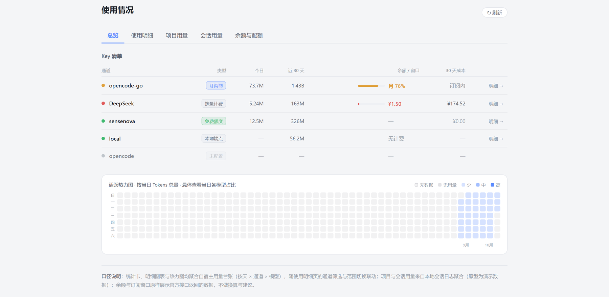
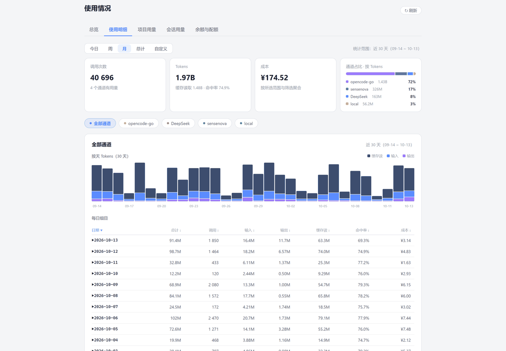
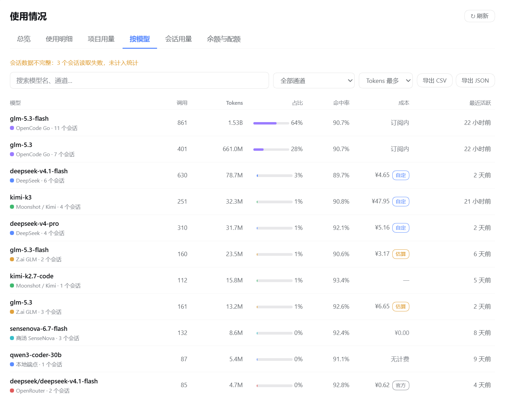
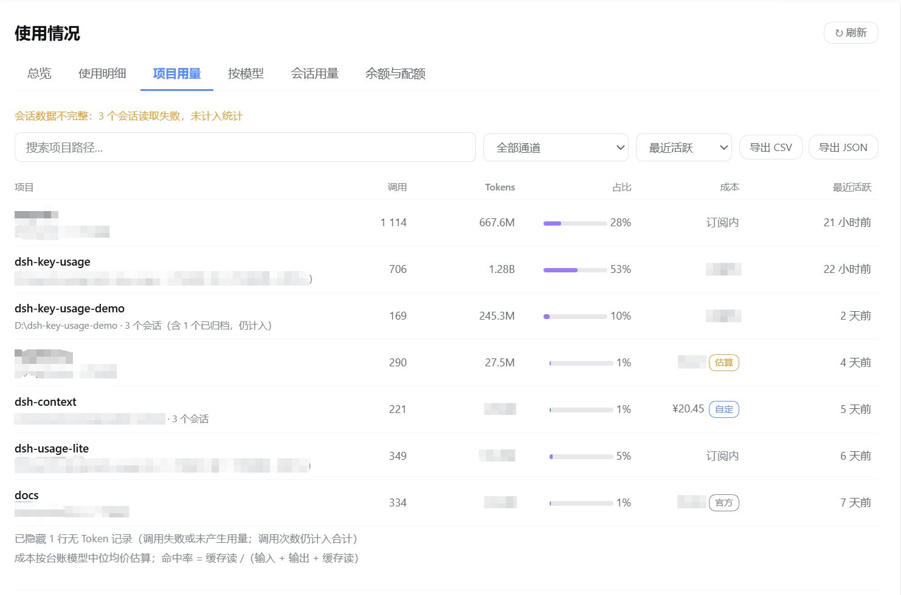
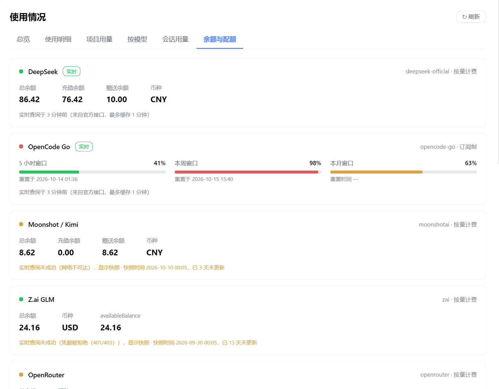

<div align="center">

# 使用情况 · dsh-key-usage

**DeepSeek Harness 的侧边栏用量面板** —— 按通道看 Token、缓存命中率、成本，以及余额与订阅窗口。

[](https://www.npmjs.com/package/dsh-key-usage)
[](./LICENSE)
[](#兼容与运行要求)
[](#兼容与运行要求)
[](https://github.com/topics/dsh-plugin)

[界面预览](#界面预览) · [安装](#安装) · [数据与权限](#数据权限与联网) · [功能](#功能) · [成本与内置价目](#成本与内置价目) · [常见问题](#常见问题) · [开发](#开发)

</div>

---

装上之后，左侧边栏会多一项「使用情况」，点开就是整页用量面板：**总览（Key 清单 + 活跃热力图）、使用明细、项目用量、按模型、会话用量、余额与配额**。数据全部来自你自己的机器，**默认不联网**。

和同类插件的三个区别：

- **台账 × 会话事件双源合并** —— 宿主台账停更时（很常见），没有记录的日期回退到本地会话事件折叠补齐，**按天取舍、不相加**，界面标明来源；
- **余额与订阅窗口是真·实时** —— 直接查各通道官方接口，查不到才回落本机快照，并把失败原因写在卡片上；
- **成本有据可依** —— **内置了一批厂商官方价目**（按官方文档抓取并注明日期），开箱即生效、不用你填；也可以写自己的规则覆盖它，四处成本都标来源角标，还能看到「缓存命中省了多少钱」。

## 界面预览

> 真实界面截图，**演示数据**（项目路径与部分金额已打码）。设计意图与早期原型见 [`docs/prototype/`](./docs/prototype/)（不代表当前界面）。

<p align="center">
  
  <br />
  <sub><b>总览</b> · Key 清单（类型 / 今日与近 30 天用量 / 余额与窗口 / 成本来源）与近 9 个月活跃热力图</sub>
</p>

<p align="center">
  
  <br />
  <sub><b>使用明细</b> · 六张统计卡、环比趋势对比、通道占比、按天图表与可展开的每日细目</sub>
</p>

<p align="center">
  
  <br />
  <sub><b>按模型</b> · 按「通道 + 模型」聚合调用数与 Tokens，成本带 官方 / 自定 / 官方价 / 估算 角标</sub>
</p>

<p align="center">
  
  <br />
  <sub><b>项目用量</b> · 按工作目录聚合调用数、Tokens、占比与最近活跃，底部标明被隐藏的零 Token 行</sub>
</p>

<p align="center">
  
  <br />
  <sub><b>余额与配额</b> · 官方余额、订阅窗口占用与计费规则面板</sub>
</p>

## 安装

```bash
dsh plugin --profile web add dsh-key-usage
```

> **桌面端**：`--profile desktop` 由 Electron 应用独占，CLI 会拒绝 —— 请在应用内的 **Plugin Hub → 安装插件** 里填 `dsh-key-usage`。

装完三步：**① 退出并重新打开 DSH**（插件树在宿主启动时组合，服务端代码没有热重载）→ **② 刷新页面**（客户端资源只需刷新）→ **③ 侧边栏出现「使用情况」**（在「上下文洞察」下方）。

<details>
<summary>其他安装方式</summary>

```bash
dsh plugin --profile web add github:xyl886/dsh-key-usage   # 从 GitHub 装（包内含构建产物）
dsh plugin --profile web add link:/path/to/dsh-key-usage   # 本地开发：软链到仓库，改文件即时生效
dsh plugin --profile web remove dsh-key-usage              # 卸载（桌面端在 Plugin Hub 里操作）
```

</details>

## 数据、权限与联网

**读什么**

| 读取对象 | 用途 | 说明 |
| --- | --- | --- |
| `$DSH_HOME/dsh-usage/usage-ledger.json` | 用量台账 | 按天 × 通道 × 模型，含官方成本 |
| `$DSH_HOME/dsh-usage/provider-snapshots.json` | 余额 / 窗口**回落值** | 仅在实时查询失败时使用 |
| `$DSH_HOME/profiles/<profile>/cordis.yml` | 通道清单 | 只做文本提取，**不执行**其中的 `!!js`；取不到回退 `cordis.patch.yml` |
| 宿主 `sessionPersistence` 服务 | 项目 / 会话 / 按小时 | 只开只读句柄（`open("read") → read(0) → close`），不自行解压会话文件 |
| 宿主 `credentials` 服务 / 进程环境变量 | 查余额时的 API Key | 只用于拼 `Authorization` 请求头 |
| 宿主 `settings` 服务 + 客户端 `configForms` | 计费规则 | 读写都走宿主设置服务，**落盘由宿主的 config-editor 完成** |

**写什么**（唯一一处）：`$DSH_HOME/dsh-key-usage/quota-snapshots.json` —— 余额与订阅窗口的快照，每次实时查询成功即原子写（临时文件 + 改名，每通道只留最新一份）；查询失败时与宿主那份**取更新的**。不含任何密钥。

三条承诺：

- **不读凭据文件** —— 从不打开 `.credentials.yaml`；密钥不落盘、不进日志、不返回前端；界面只显示 `apiKeyEnv` 这类**变量名**；
- **不改宿主配置** —— 不写宿主的 `provider-snapshots.json`，不碰其它数据文件；计费规则由宿主的配置服务保存（命名空间就是本插件在 profile 里的条目 id `dsh-key-usage`，写 patch 时会保留文件里的注释）；
- **仅回环** —— 所有端点只接受 `127.0.0.1` / `::1` 的请求，非回环一律 403。

**会联网的唯一路径**：打开「余额与配额」时按通道请求官方接口，结果缓存 60 秒（点「刷新」强制重查）。

| 通道 | 接口 |
| --- | --- |
| `opencode-go` | `GET https://opencode.ai/zen/go/v1/usage`（rolling / weekly / monthly） |
| `deepseek-official` | `GET {baseURL}/user/balance` |
| `openrouter` · `moonshotai` · `zai` | 各自的官方余额接口 |

请求 6 秒超时、响应上限 64 KiB、只发 `Authorization` 与 `Accept` 两个头；任何失败都回落本机快照并在卡片上写明原因（未配置 Key / 网络不可达 / 401 / 超时）。

## 功能

**总览**

- **Key 清单** —— 每通道一行：类型（按量计费 / 免费额度 / 本地端点 / 订阅制）、今日与近 30 天调用量、余额或订阅窗口占用、30 天成本（带来源角标）；
- **活跃热力图** —— 近 9 个月按日 Tokens，格子按可见区间的**活跃日三分位**分档（少 / 中 / 高），悬停看当日各模型 Token 与占比。

**使用明细**

- 今日 / 周 / 月 / 总计 / 自定义范围 + 按通道筛选，全页联动；
- **六张统计卡**（调用次数、Tokens、缓存读、缓存命中率、日均 Tokens、成本）**+ 环比趋势对比**（与上一段等长范围比这四个指标，命中率按百分点计；`总计` 没有可比区间时会说明）；
- **通道占比条**、**按天 / 按小时图表**（单日范围自动切 24 小时）、**每日细目**（每天一行，可展开到模型级）。

**项目用量 · 按模型 · 会话用量**

- 分别按**工作目录**、**通道 + 模型**、**单个会话**聚合调用数 / Tokens / 占比 / 命中率 / 成本 / 最近活跃；都支持搜索、按通道筛选、按列排序；会话按日期分组，可切换显示已归档会话。

**导出**

- 上面四处都能把**当前筛选后**的数据导出为 CSV 或 JSON（CSV 带 UTF-8 BOM，Excel 打开中文不乱码）。

**余额与配额**

- 每个通道一张卡片：官方余额（如 DeepSeek 的总余额 / 赠送 / 充值）或订阅窗口占用（opencode-go 的 5 小时 / 本周 / 本月 + 重置时间）；成功带「实时」标签与查询时间，失败写明原因并回落快照。

**计费规则**（在「余额与配额」页下半部分，插件页也有同一面板）

- **内置官方价目自动生效**，开箱即用；需要覆盖时再写自己的规则（通道 · 模型 · 单位 · 四档单价 · 币种 · 错峰时段 · 备注）；
- **最值得补规则的模型** —— 按 Tokens 占比列出目前只有估算的模型，一键为它新增规则（表单自动预填通道与模型）；
- 支持**导入 / 导出 JSON** 与**清空规则**（回到内置价目 + 台账反推均价）。

## 成本与内置价目

**取值优先级**：`官方账单`（台账记录的厂商账单，最可信、不会被覆盖）→ `你的规则` → `内置官方价目` → `台账反推均价`；都没有则显示 `—`。

| 角标 | 含义 |
| --- | --- |
| **官方** | 台账记录的厂商账单金额 |
| **自定** | 按你自己填的计费规则算出 |
| **官方价** | 按插件**内置的官方价目**算出（自动生效，来源与抓取日期可查） |
| **估算** | 内置价目也没收录时，按台账反推的均价推算 |

**内置价目覆盖**（共 18 条，2026-10-13 抓取）：

| 通道 | 模型 | 币种 | 来源 |
| --- | --- | --- | --- |
| `deepseek-official` | deepseek-flash · deepseek-v4-flash · deepseek-v4-flash-vision-exp · deepseek-v4-pro | CNY | [api-docs.deepseek.com](https://api-docs.deepseek.com/zh-cn/quick_start/pricing) |
| `moonshotai` | kimi-k3 · kimi-k2.7-code · kimi-k2.7-code-highspeed · kimi-k2.6 | CNY | [platform.kimi.com](https://platform.kimi.com/docs/pricing/chat) |
| `zai` | glm-5.3 · glm-5.3-flash · glm-5.3-flashx · glm-5.2 · glm-5 | USD | [docs.z.ai](https://docs.z.ai/guides/overview/pricing) |
| `openrouter` | deepseek/deepseek-v4.1-flash · anthropic/claude-sonnet-5.5 · anthropic/claude-opus-5.5 · openai/gpt-6.1-sol · openai/gpt-6-astra | USD | [openrouter.ai](https://openrouter.ai/api/v1/models) |

- 币种按各家定价页**原样记录，不做汇率换算**：DeepSeek / Kimi 与账户币种一致（CNY），GLM / OpenRouter 为 USD；不同币种分别展示、不合计；
- **运行时不联网抓价**：价目是静态数据（`src/server/pricing-catalog.ts`），每条带来源 URL 与抓取日期，厂商调价后需人工更新；文档没写清的档位**留空而不是猜**（例如 Kimi K2 系列未公布缓存写入价 → 该档按 0 计）；
- **错峰怎么算**：窗口按**本地时间**判定（`起止相同` = 全天，`from > to` = 跨午夜），每个窗口可限定**每天 / 仅工作日 / 仅周末**；只有**单日范围**会用当天的 24 小时分布算错峰占比并加权，跨天 / 会话 / 项目 / 按模型按标准价算（有意保守）。内置的 DeepSeek 价目按官方口径：**北京时间周一至周五 9:00–12:00 与 14:00–18:00 为高峰，其余（含周末全天）为空闲（半价）**；插件没有中国法定节假日日历，**节假日会按高峰价算**（金额偏高、保守），是已知近似；
- 完整明细、单位换算与全部已知近似见 [`docs/05-后续版本计划.md`](./docs/05-后续版本计划.md) 附录 A.5。

## 常见问题

<details>
<summary><b>装了新版，界面怎么还是旧的</b></summary>

宿主必须**完全退出**再重开（不是关窗口、不是刷新页面）：插件在宿主启动时组合，客户端资源也在启动时注册进内存，只替换磁盘上的包不会生效。重开后再 `Ctrl + Shift + R` 清一次浏览器缓存。桌面端用户最容易遇到 —— 重装插件也不会重新导入服务端模块。
</details>

<details>
<summary><b>Windows 上 pnpm 安装报 EPERM（无法创建符号链接）</b></summary>

未开启开发者模式时 Windows 不允许创建符号链接，而 pnpm 安装本插件需要链接宿主提供的 peer 依赖（`@deepseek-ai/cordis` / `@deepseek-ai/schemastery`）。DSH 自带的安装器不安装 peer 依赖，所以用 Plugin Hub 安装不受影响；必须用 pnpm 时请开启开发者模式或以管理员身份运行。计划在下一版把 `schemastery` 标为 optional peer 以彻底规避。
</details>

<details>
<summary><b>余额卡片显示「该通道未配置 API Key」</b></summary>

需要宿主 `credentials` 能解析该通道的 `apiKeyEnv`（如 `OPENCODE_GO_API_KEY`），或该变量存在于宿主进程环境里。解析不到时插件不会去读凭据文件，而是直接回落快照。
</details>

<details>
<summary><b>填了规则但成本没变</b></summary>

规则按 `通道 id + 模型 id` 匹配（精确 → `通道+*` → `*+模型` → `*+*`）。先确认规则里的通道 / 模型 id 与页面显示一致（模型 id 可能带尾随空格，从「使用明细」复制最稳）。另外，**台账已经记录了官方成本的那些天不会被规则覆盖** —— 这是有意的。
</details>

<details>
<summary><b>成本显示为 0 / 「无计费」</b></summary>

免费额度与本地端点没有成本概念；由会话事件补位的日期、以及项目 / 会话 / 按小时视图也没有官方成本。想让它有数字，先看这个模型是否在**内置价目覆盖表**里；没覆盖就在计费规则里手填单价。
</details>

<details>
<summary><b>热力图的颜色深浅怎么定</b></summary>

按可见区间内**活跃日的三分位**分档（p33 / p67），不是固定阈值 —— 这样低用量和高用量都能看出层次。
</details>

<details>
<summary><b>卸载后侧边栏还有图标</b></summary>

客户端资源需要刷新页面，服务端需要退出重开 DSH。桌面端的卸载同样在 Plugin Hub 里操作。
</details>

## 兼容与运行要求

| 项 | 要求 |
| --- | --- |
| DeepSeek Harness | 桌面端 0.2.x（客户端 slot：`sidebar.panellist` + `main`，配置服务 `configForms`）；web profile 同样支持 |
| Node.js | ≥ 22（宿主内置） |
| 运行时依赖 | 无。`react` / `react/jsx-runtime` 由宿主注入，服务端只用 Node 内置模块；`@deepseek-ai/schemastery` 与 `@deepseek-ai/dsh-client-ui-settings` 由宿主提供，前者按 `peerDependencies` 走宿主 runtime resolution（缺失时计费面板降级为只读 + 导入导出） |
| 必需服务 | 无 |
| 可选服务 | `sessionPersistence`（缺失时项目 / 会话 / 按小时为空态）、`credentials`（缺失时余额只读快照）、`settings` / `configForms`（缺失时计费规则只能导入导出、成本按台账均价估算） |

## 开发

```bash
pnpm install          # 依赖（CI 用 pnpm，见 .github/workflows/ci.yml）
pnpm run build        # 服务端 → lib/，客户端 → client/client.js（含产物头校验）
pnpm run typecheck    # 客户端 + 服务端类型检查
pnpm run test         # 10 个离线测试
pnpm run check        # lib/*.js 语法检查
pnpm run verify       # 上面全套（CI 跑的就是这条）
pnpm run pack:dry     # 发布清单自检
```

> 本目录的 `node_modules` 目前是 pnpm 10.32.1 装的；用**不同大版本**的 pnpm 执行 `pnpm run` 会触发「清空 modules 目录」而中止。此时改用 `npm run <script>`（等价），或先按 `packageManager` 字段对齐 pnpm 版本再重装依赖。

**改动生效条件**（最容易踩的坑）：

| 改动 | 生效方式 |
| --- | --- |
| `src/client/**` | `pnpm run build` → **刷新页面** |
| `src/server/**` | `pnpm run build` → **退出重开 DSH**（模块在宿主启动时进入 ESM 缓存，重装插件也不会重新导入） |

**验证安装**（9 个端点全部是只读 `GET`、只接受回环请求）：

```bash
curl -s http://127.0.0.1:19387/dsh-key-usage/channels   # 返回 { channels: [...] } 即已挂载
```

**CI**：[`.github/workflows/ci.yml`](./.github/workflows/ci.yml) 在 push / PR 上跑 `pnpm run verify`，另加「构建产物必须与源码同步」与「发布包必须含三件套」两道闸；发布由人工触发 [`publish.yml`](./.github/workflows/publish.yml)（带 provenance 签名）。

目录结构、产物契约（`lib/` 与 `client/` 为什么必须提交、构建为什么要与机器无关）与计费规则的离线自检见 [`docs/06-开发与构建.md`](./docs/06-开发与构建.md)。

## 延伸文档

[架构与数据契约](./docs/01-架构与数据契约.md) · [原型差异清单](./docs/02-原型差异与优化清单.md) · [按 Tab 重构方案](./docs/03-按Tab拆分重构方案.md) · [会话归档的影响](./docs/04-归档会话的影响与对策.md) · [后续版本计划](./docs/05-后续版本计划.md) · [开发与构建](./docs/06-开发与构建.md) · [AGENTS.md](./AGENTS.md)

## 许可证

[MIT](./LICENSE) © 2026 xyl886

非官方社区插件，与 DeepSeek 无隶属关系。
